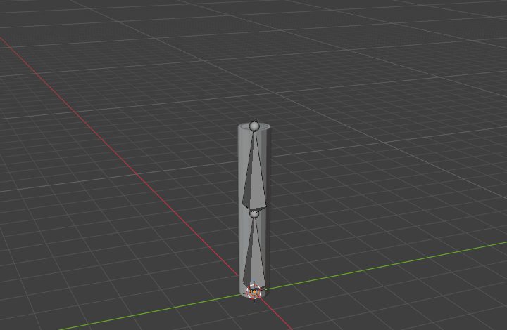
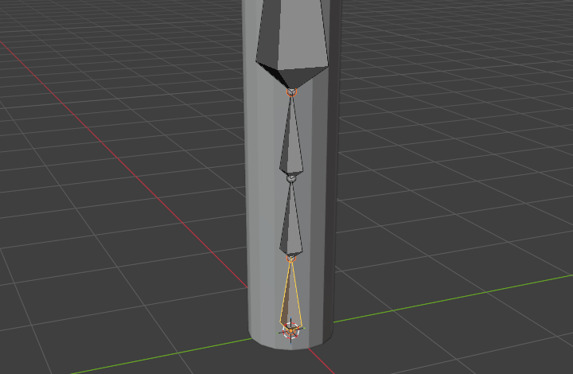
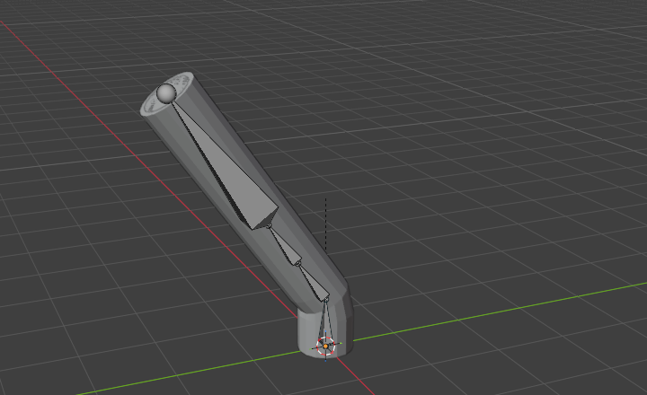
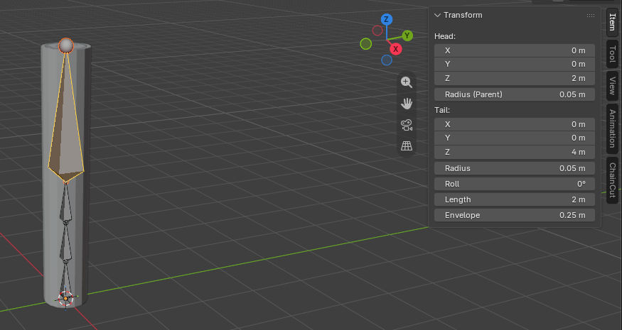

# ChainCut – Bone Chain Slicer

Blender add-on (Blender **5.2+**) that splits the selected bones into **2–8 connected segments** and **redistributes vertex-group weights** on every mesh that uses the armature, with adjustable smoothing.

Blender's native *Subdivide* splits the bone but leaves vertex weights untouched and names the new bones `.001`, `.002`. ChainCut keeps clean names (`Upper`, `Upper_2`, `Upper_3`…), a connected chain, re-parented children, and weights that stay non-negative and sum exactly to the original value.

| Before (Edit Mode) | After (3 segments) | Pose: smooth bend |
|---|---|---|
|  |  |  |

## Use
1. Select the armature → Edit Mode → select the bones to split.
2. `View3D › Sidebar (N) › ChainCut` tab → **Split Bones and Weights**.
3. Set *Segments* (2–8) and *Smoothness* (0–1) → OK.



## Install
Download `chaincut-0.1.0.zip` from the project's marketplace page / releases, then *Edit › Preferences › Add-ons › Install from Disk* — or extract the `chaincut/` folder into your Blender `scripts/addons` directory.

## Limits (honest list)
- Constraints of the original bone are not copied to the new segments.
- Only meshes that use the armature (Armature modifier pointing to it, or parented to it) are modified.
- Blender 5.2+ only (tested on 5.2.2 LTS); older versions are not covered.
- No symmetry and no live preview.

## Local-only
The add-on does not include or call AI services and makes no network calls (checked by an AST scan in the test harness).

## Testing
`tests/` contains the headless harness and the acceptance tests: 12 scenarios (N ∈ {2,3,5,8} × smoothness ∈ {0,0.5,1}), no-mesh case, two meshes with a moved armature, a foreign mesh left untouched, and the operator poll. Last run: Blender 5.2.2 LTS, **18/18 checks**, exit 0 (`tests/r_chaincut.json`).

```
blender --background --python tests/harness.py -- --addon chaincut --tests tests/chaincut_tests.py --out r.json
```

## Development disclosure
Development was AI-assisted. Functional direction, design, integration testing and final approval: Jalvart Studio.

## License
GPL-3.0-or-later. © Jalvart Studio.
